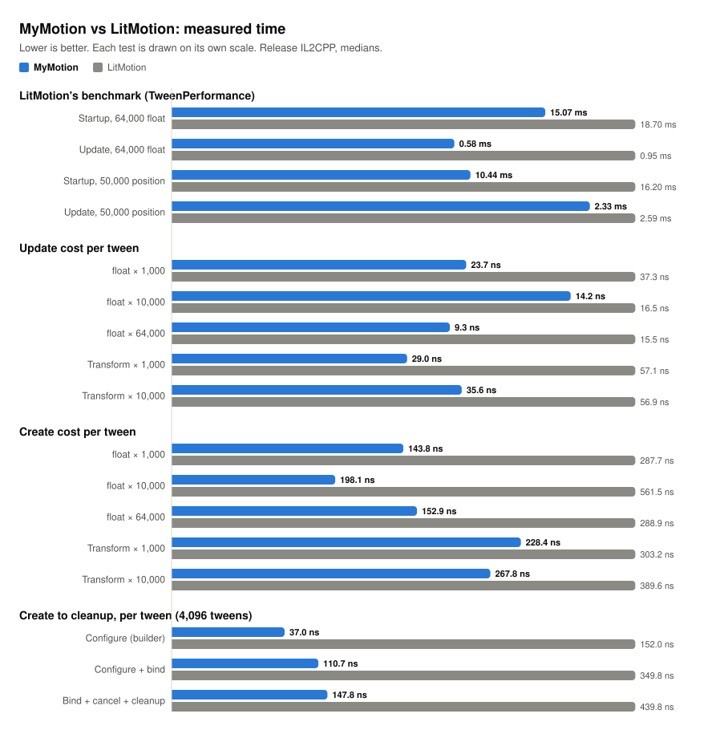
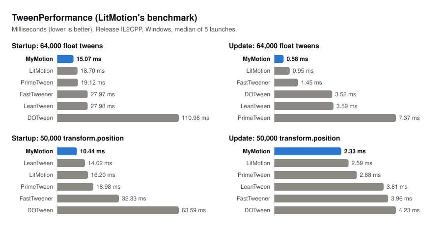
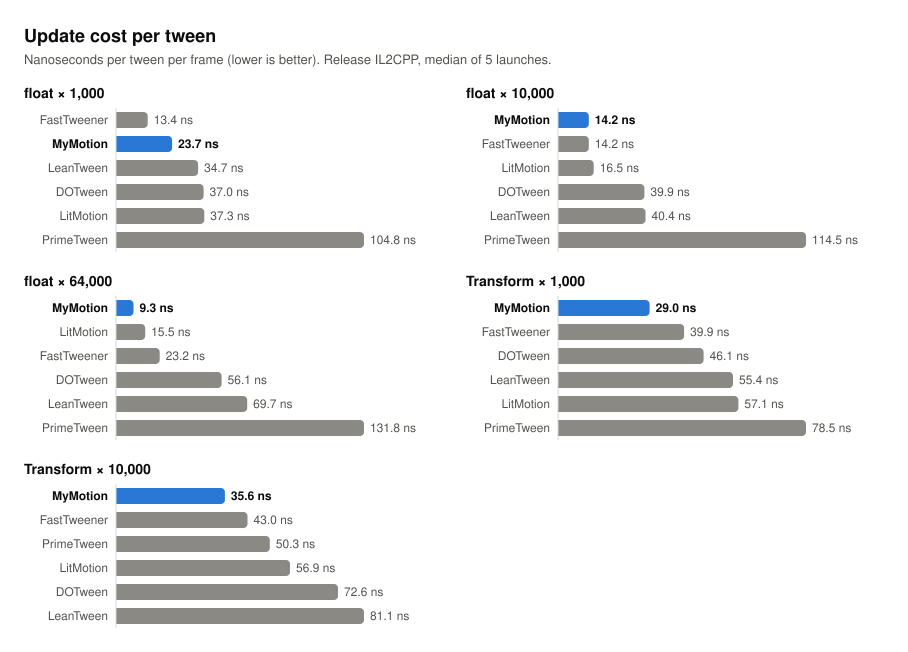
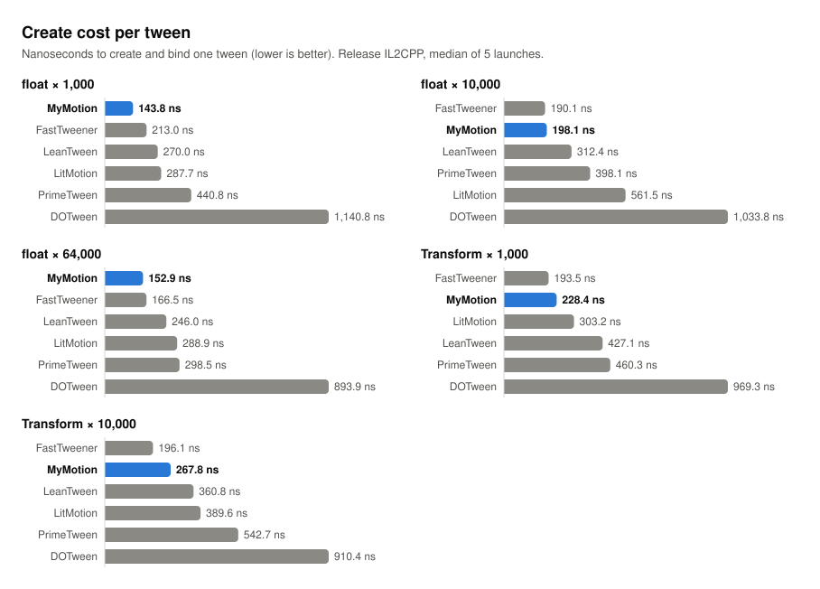
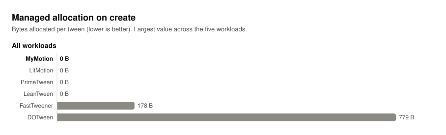

# MyMotion

[](LICENSE)


[日本語版 README はこちら](README_JA.md)

MyMotion is a high-performance tween library for Unity. Its API mirrors [LitMotion](https://github.com/annulusgames/LitMotion), so existing LitMotion code moves over by renaming a few identifiers. Underneath, the runtime has been rebuilt around a Burst-compiled data-oriented core that is faster than LitMotion in all 17 tests we ran and ranks first of six libraries in [LitMotion's own benchmark](#litmotions-own-benchmark).

```csharp
using MyMotion;
using MyMotion.Extensions;

MMotion.Create(Vector3.zero, new Vector3(5f, 0f, 0f), 1f)
    .WithEase(Ease.OutQuad)
    .BindToPosition(transform)
    .AddTo(gameObject);
```

## At a glance

All numbers are measured on Release IL2CPP players; see [Performance](#performance) for the method.

- **Faster than LitMotion in all 17 tests we ran.** For example, updating 64,000 float tweens takes 0.58 ms per frame against LitMotion's 0.95 ms, and creating one tween takes 143.8 ns against 287.7 ns (chart below).
- **No. 1 of 6 libraries in all four timing tests of [LitMotion's own benchmark](#litmotions-own-benchmark)**, against LitMotion, PrimeTween, DOTween, LeanTween, and FastTweener.
- **Fastest in 10 of 14 timing tests overall.** In the other four, MyMotion is second, behind FastTweener, which skips applying the start value at bind time and allocates 143–563 bytes per tween.
- **Against other popular libraries:** creating one float tween takes 143.8 ns against DOTween's 1,140.8 ns, and updating one takes 9.3 ns against PrimeTween's 131.8 ns.
- **0 bytes of GC allocation per tween.** DOTween allocates 780 B, FastTweener 563 B, and LeanTween 293 B per position tween.
- **No idle cost.** After 64,000 tweens finish, MyMotion's update takes 0.0002 ms per frame; LitMotion keeps scanning its storage at 0.24 ms per frame.



## Features

- **LitMotion-compatible API**: `MMotion.Create(...).With*().Bind(...)`, `MSequence`, `MotionHandle`, and the same extension method names (`BindToPosition`, `BindToColor`, `BindToText`, ...).
- **Fast**: values are evaluated by Burst jobs, bindings are dispatched from a compact per-frame record, and large worlds overlap evaluation with binding across worker threads.
- **Zero allocation**: creating, running, and finishing a motion allocates no managed memory (verified by static analysis of the IL2CPP output and by benchmarks).
- **No idle cost**: when no motions are running, the per-frame cost is effectively zero, regardless of how many motions ran before.
- **Reusable builders**: a `MotionBuilder` is an immutable value; you can bind the same configuration any number of times.
- **Unmanaged handles**: `MotionHandle` contains no managed references, so storing handles costs nothing extra.
- Value types: `float`, `double`, `int`, `long`, `Vector2`, `Vector3`, `Vector4`, `Quaternion`, `Color`, `Rect`, `FixedString*Bytes`, plus custom types through `IMotionAdapter<TValue, TOptions>`.
- Easing, delays, loops (Restart / Flip / Yoyo / Incremental), playback speed, time scale modes, custom `AnimationCurve` easing.
- Punch, Shake, and text (scramble, rich text) motions.
- Sequences (`MSequence`), `async`/`await`, coroutines, `Awaitable`, `ValueTask`.
- PlayerLoop scheduling (Initialization to PostLateUpdate, scaled/unscaled/realtime) and manual scheduling with `ManualMotionDispatcher`.
- Integrations: uGUI, TextMeshPro, UI Toolkit, SRP Volume, Visual Effect Graph, UniTask, R3, UniRx.
- Inspector-driven animation components (`MyMotion Animation`) and a Motion Debugger window.

## Requirements

- Unity 6000.5 or later
- Burst 1.8.26, Collections 2.6.3, Mathematics 1.3.3 (installed automatically as dependencies)

## Installation

Open **Window > Package Manager**, choose **+ > Install package from git URL...**, and enter:

```text
https://github.com/seikasan/MyMotion.git?path=/src/MyMotion/Assets/MyMotion
```

Or add it to `Packages/manifest.json`:

```json
{
  "dependencies": {
    "com.seikasan.mymotion": "https://github.com/seikasan/MyMotion.git?path=/src/MyMotion/Assets/MyMotion"
  }
}
```

Integrations with uGUI, TextMeshPro, UniTask, and other packages are enabled automatically when those packages are present in your project. See [Package reference](docs/package-reference.md) for the list.

## Getting started

### Create and bind a motion

```csharp
using MyMotion;
using MyMotion.Extensions;
using UnityEngine;

public sealed class Example : MonoBehaviour
{
    [SerializeField] private Transform target;
    private float value;

    private void Start()
    {
        // Animate a Transform.
        MMotion.Create(Vector3.zero, Vector3.one, 0.5f)
            .WithEase(Ease.OutBack)
            .BindToLocalScale(target);

        // Animate anything with a callback. Passing the state avoids closure allocations.
        MMotion.Create(0f, 10f, 2f)
            .Bind(this, static (x, self) => self.value = x);
    }
}
```

By default, `Bind` applies the start value immediately. Call `.WithImmediateBind(false)` to apply the first value on the next update instead.

### Options

```csharp
MMotion.Create(0f, 1f, 1f)
    .WithEase(Ease.InOutSine)
    .WithDelay(0.5f)
    .WithLoops(3, LoopType.Yoyo)
    .WithScheduler(MotionScheduler.UpdateIgnoreTimeScale)
    .WithOnComplete(() => Debug.Log("done"))
    .Bind(x => Debug.Log(x));
```

### Control a motion

```csharp
MotionHandle handle = MMotion.Create(0f, 1f, 2f).Bind(x => Debug.Log(x));

handle.PlaybackSpeed = 2f;   // change speed
handle.Time = 0.5;           // seek
handle.Complete();           // jump to the end
handle.Cancel();             // stop

if (handle.IsActive()) { /* ... */ }
handle.TryCancel();          // no exception if the motion has already finished

handle.AddTo(gameObject);    // cancel when the GameObject is destroyed
```

### Sequences

```csharp
MSequence.Create()
    .Append(MMotion.Create(0f, 1f, 0.5f).BindToPositionX(target))
    .Join(MMotion.Create(0f, 1f, 0.5f).BindToPositionY(target))
    .AppendInterval(0.25f)
    .Insert(0.1f, MMotion.Create(1f, 2f, 0.3f).BindToLocalScaleX(target))
    .Run();
```

### Awaiting

```csharp
await MMotion.Create(0f, 1f, 1f).Bind(x => Debug.Log(x));                 // await directly
await MMotion.Create(0f, 1f, 1f).Bind(x => Debug.Log(x)).ToAwaitable(token);
yield return MMotion.Create(0f, 1f, 1f).Bind(x => Debug.Log(x)).ToYieldInstruction();
// With UniTask installed:
await MMotion.Create(0f, 1f, 1f).Bind(x => Debug.Log(x)).ToUniTask(token);
```

### Punch, Shake, and text

```csharp
MMotion.Punch.Create(Vector3.zero, Vector3.one, 0.5f)
    .WithFrequency(10)
    .WithDampingRatio(0.5f)
    .BindToLocalPosition(target);

MMotion.Shake.Create(Vector3.zero, Vector3.one * 0.2f, 0.5f)
    .BindToLocalPosition(target);

// With TextMeshPro:
MMotion.String.Create64Bytes("", "Hello, MyMotion!", 1f)
    .WithScrambleChars(ScrambleMode.Lowercase)
    .BindToText(tmpText);
```

### Manual updates

```csharp
using var dispatcher = new ManualMotionDispatcher();

MMotion.Create(0f, 1f, 1f)
    .WithScheduler(dispatcher.Scheduler)
    .Bind(x => Debug.Log(x));

dispatcher.Update(0.1); // advance by 0.1 seconds
```

### Custom value types

Implement `IMotionAdapter<TValue, TOptions>` and pass it to the generic `MMotion.Create<TValue, TOptions, TAdapter>(start, end, duration)`.

## Migrating from LitMotion

MyMotion keeps LitMotion's method names and behavior. Most code only needs these renames:

| LitMotion | MyMotion |
|---|---|
| `using LitMotion;` | `using MyMotion;` |
| `using LitMotion.Extensions;` | `using MyMotion.Extensions;` |
| `LMotion.Create(...)` | `MMotion.Create(...)` |
| `LMotion.Punch` / `Shake` / `String` | `MMotion.Punch` / `Shake` / `String` |
| `LSequence.Create()` | `MSequence.Create()` |
| `LitMotionAnimation` component | `MyMotionAnimation` component |

Differences to be aware of:

- Builders are immutable values and can be bound more than once. `Dispose()` exists only for `using` compatibility and does nothing.
- `MotionHandle` holds no managed references. Handles of a disposed `ManualMotionDispatcher` simply become invalid.
- MyMotion requires Unity 6000.5 or later.

See [Migrating from LitMotion](docs/migration-from-litmotion.md) for details.

## Performance

Environment for every result below: Windows 11, Core i7-1185G7, Unity 6000.6.8f1, Release IL2CPP player, LitMotion 2.0.2, PrimeTween 1.5.3. Each library and test ran in its own process five times, and the values are medians. Results depend on hardware, Unity version, and workload.

### Ranking

| Test | MyMotion's place (of 6) | MyMotion | LitMotion | Best of the others |
|---|:---:|---:|---:|---|
| LitMotion's benchmark: startup, 64,000 float | **1st** | 15.07 ms | 18.70 ms | LitMotion 18.70 ms |
| LitMotion's benchmark: update, 64,000 float | **1st** | 0.58 ms | 0.95 ms | LitMotion 0.95 ms |
| LitMotion's benchmark: startup, 50,000 position | **1st** | 10.44 ms | 16.20 ms | LeanTween 14.62 ms |
| LitMotion's benchmark: update, 50,000 position | **1st** | 2.33 ms | 2.59 ms | LitMotion 2.59 ms |
| Update per tween: float × 1,000 | 2nd | 23.7 ns | 37.3 ns | FastTweener 13.4 ns |
| Update per tween: float × 10,000 | **1st** (tie) | 14.2 ns | 16.5 ns | FastTweener 14.2 ns |
| Update per tween: float × 64,000 | **1st** | 9.3 ns | 15.5 ns | LitMotion 15.5 ns |
| Update per tween: Transform × 1,000 | **1st** | 29.0 ns | 57.1 ns | FastTweener 39.9 ns |
| Update per tween: Transform × 10,000 | **1st** | 35.6 ns | 56.9 ns | FastTweener 43.0 ns |
| Create per tween: float × 1,000 | **1st** | 143.8 ns | 287.7 ns | FastTweener 213.0 ns |
| Create per tween: float × 10,000 | 2nd | 198.1 ns | 561.5 ns | FastTweener 190.1 ns |
| Create per tween: float × 64,000 | **1st** | 152.9 ns | 288.9 ns | FastTweener 166.5 ns |
| Create per tween: Transform × 1,000 | 2nd | 228.4 ns | 303.2 ns | FastTweener 193.5 ns |
| Create per tween: Transform × 10,000 | 2nd | 267.8 ns | 389.6 ns | FastTweener 196.1 ns |

MyMotion applies the start value at `Bind` time, like LitMotion. FastTweener does not, and allocates memory per tween instead; this accounts for most of its lead in the create tests. `WithImmediateBind(false)` removes that work from MyMotion when you do not need it.

### LitMotion's own benchmark

LitMotion's README publishes results from [TweenPerformance](https://github.com/AnnulusGames/TweenPerformance). We reproduced its four timing tests and its allocation test with the same tween code and the same measurement rules: a single `Run()` for startup, and the median frame time over 600 frames for update. Update is the whole frame time, so it includes Unity's own per-frame cost, as in the original.



| Test | MyMotion | LitMotion | PrimeTween | FastTweener | LeanTween | DOTween |
|---|---:|---:|---:|---:|---:|---:|
| Startup, 64,000 float | **15.07 ms** | 18.70 ms | 19.12 ms | 27.97 ms | 27.98 ms | 110.98 ms |
| Update, 64,000 float | **0.58 ms** | 0.95 ms | 7.37 ms | 1.45 ms | 3.59 ms | 3.52 ms |
| Startup, 50,000 position | **10.44 ms** | 16.20 ms | 18.98 ms | 32.33 ms | 14.62 ms | 63.59 ms |
| Update, 50,000 position | **2.33 ms** | 2.59 ms | 2.88 ms | 3.96 ms | 3.81 ms | 4.23 ms |
| GC per position tween | **0 B** | 0 B | 0 B | 563 B | 293 B | 780 B |

Source and raw data: [docs/benchmarks/TweenPerformance](docs/benchmarks/TweenPerformance/README.md).

### Cost per tween

This benchmark isolates each library's own cost: the update time is the main-thread time from Update to PreLateUpdate minus the same frame without tweens, divided by the number of tweens.







Full tables and method: [Performance comparison](docs/performance.md) (Japanese).

### Create, cancel, and cleanup

Building, binding, cancelling, and cleaning up 4,096 tweens, compared with LitMotion in the same process (`create_breakdown`, five launches):

| Stage (per tween) | MyMotion | LitMotion |
|---|---:|---:|
| Configure (builder) | 37 ns | 152 ns |
| Configure + bind | 111 ns | 350 ns |
| Bind + cancel + cleanup | 148 ns | 440 ns |

### Idle cost

LitMotion's update loop walks the whole storage it has ever grown to, even when no tween is running. MyMotion only walks running tweens. Update system time per frame after all tweens have finished (raw data: [idle-after-peak-20261124.csv](docs/results/idle-after-peak-20261124.csv)):

| Peak tween count | MyMotion | LitMotion |
|---|---:|---:|
| 1,000 | 0.0001 ms | 0.0052 ms |
| 10,000 | 0.0001 ms | 0.0774 ms |
| 64,000 | 0.0002 ms | 0.2412 ms |

## Documentation

- [Installation](docs/installation.md)
- [Quick start](docs/quick-start.md)
- [Package reference](docs/package-reference.md)
- [Migrating from LitMotion](docs/migration-from-litmotion.md)
- [Performance comparison](docs/performance.md)

The documents under `docs/` are written in Japanese.

## Repository layout

- `src/MyMotion` — Unity project used for development and testing. Open it with Unity 6000.6.8f1 or later.
- `src/MyMotion/Assets/MyMotion` — the UPM package (`com.seikasan.mymotion`).
- `docs` — documentation and benchmark results.

## License

MyMotion is released under the [MIT License](LICENSE).

Parts of MyMotion (the animation components, some editor drawers, the fixed-string interpolation code, and the ported runtime tests) are adapted from [LitMotion](https://github.com/annulusgames/LitMotion) by Yusuke Nakada, also under the MIT License. See [Third party notices](src/MyMotion/Assets/MyMotion/ThirdPartyNotices.md).
