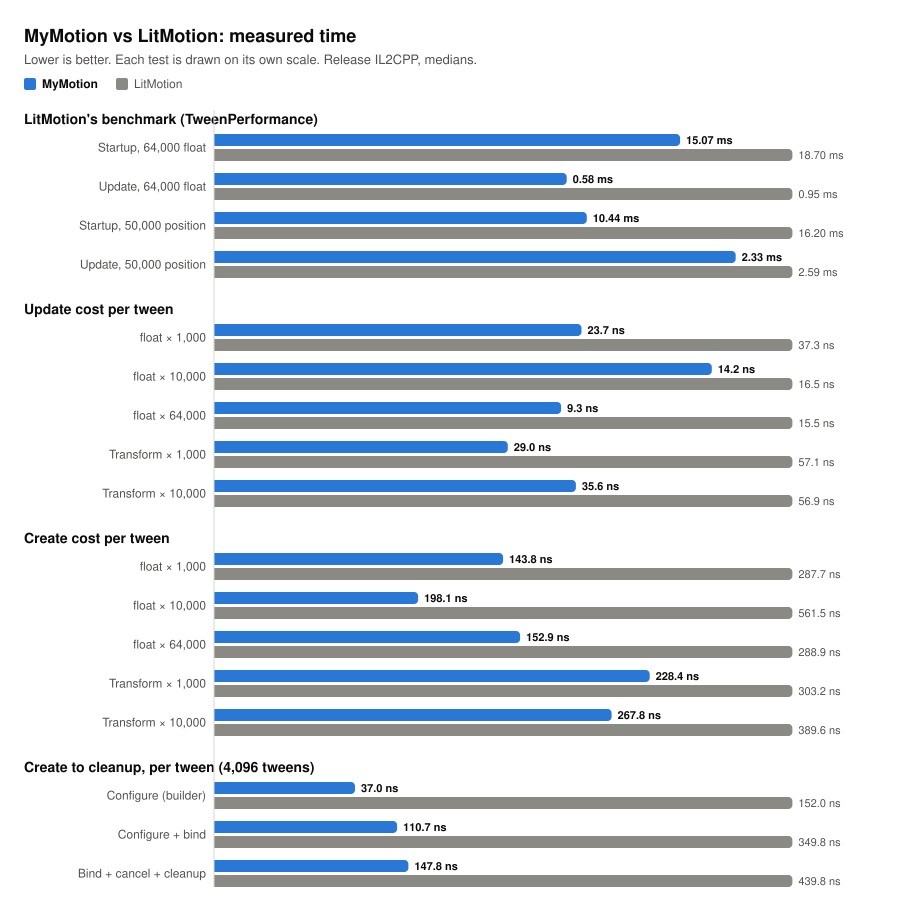
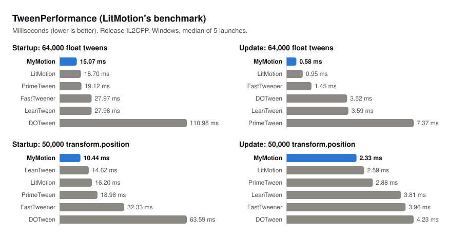
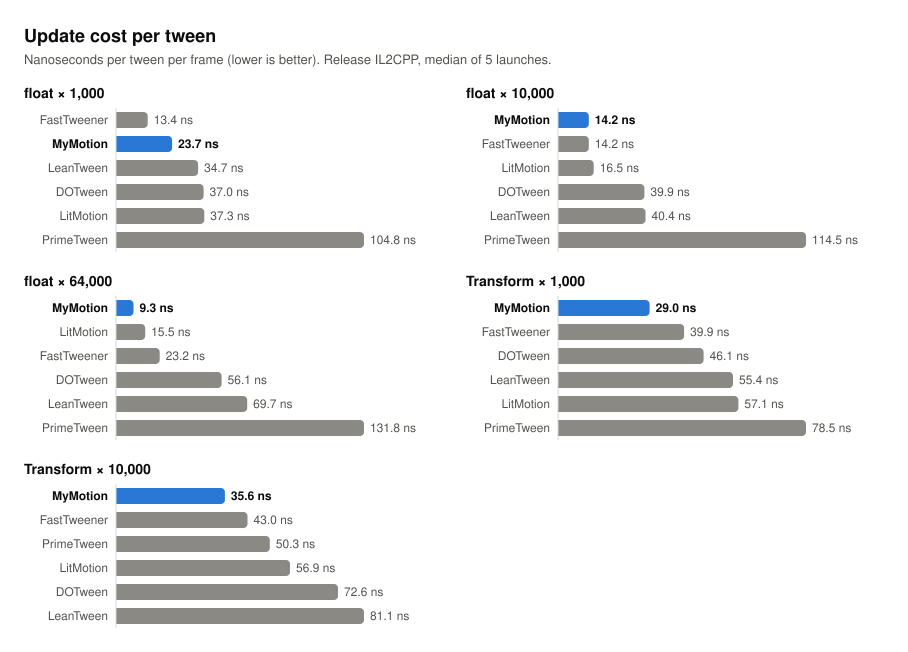
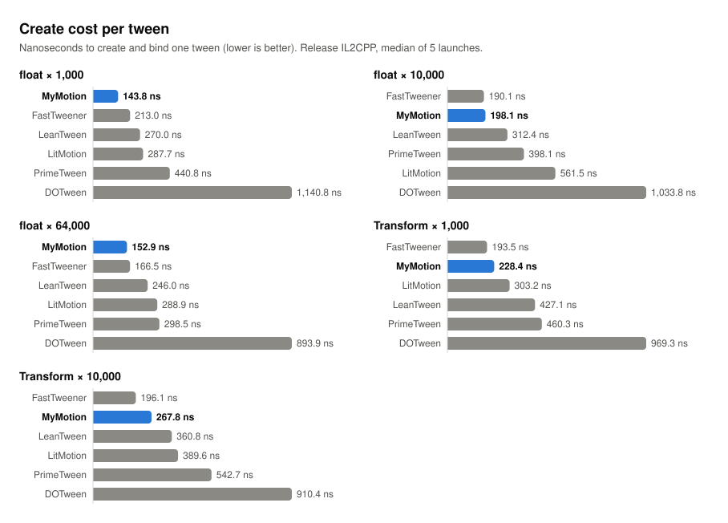
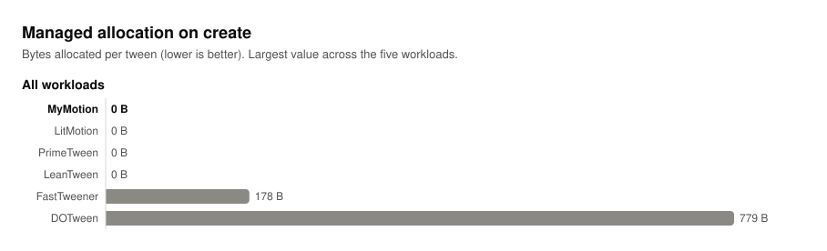

# MyMotion

[](LICENSE)


[English README](README.md)

MyMotion は Unity 向けの高速な Tween ライブラリです。API は [LitMotion](https://github.com/annulusgames/LitMotion) と同じ形にしてあり、既存の LitMotion のコードはいくつかの名前を置き換えるだけで移行できます。内部は Burst でコンパイルするデータ指向の実装に作り直しています。計測した全17項目で LitMotion より速く、[LitMotion 本家のベンチマーク](#litmotion-本家のベンチマーク)でも6ライブラリ中1位です。

```csharp
using MyMotion;
using MyMotion.Extensions;

MMotion.Create(Vector3.zero, new Vector3(5f, 0f, 0f), 1f)
    .WithEase(Ease.OutQuad)
    .BindToPosition(transform)
    .AddTo(gameObject);
```

## ひと目でわかる性能

数値はすべて Release IL2CPP Player での実測です。計測方法は[性能](#性能)を参照してください。

- **計測した全17項目で LitMotion より速いです。** 例えば、float の Tween 64,000件の更新は1フレーム 0.58 ms（LitMotion は 0.95 ms）、Tween 1件の作成は 143.8 ns（LitMotion は 287.7 ns）です（下のグラフ）。
- **[LitMotion 本家のベンチマーク](#litmotion-本家のベンチマーク)の時間計測4項目すべてで、6ライブラリ中1位です。** 比べたのは LitMotion、PrimeTween、DOTween、LeanTween、FastTweener です。
- **時間計測14項目のうち10項目で1位、残り4項目は2位です。** 1位は FastTweener ですが、FastTweener は Bind 時に開始値を適用せず、Tween 1件ごとに 143〜563 byte を割り当てます。
- **他の主要ライブラリとの比較:** float の Tween 1件の作成は 143.8 ns（DOTween は 1,140.8 ns）、更新は 9.3 ns（PrimeTween は 131.8 ns）です。
- **GC アロケーションは Tween 1件あたり 0 byte です。** position の Tween 1件あたりで、DOTween は 780 B、FastTweener は 563 B、LeanTween は 293 B を割り当てます。
- **待機中のコストがありません。** 64,000 件の Tween が終わった後、MyMotion の更新は1フレーム 0.0002 ms です。LitMotion は storage の走査を続け、1フレーム 0.24 ms かかります。



## 特長

- **LitMotion 互換の API**
  - `MMotion.Create(...).With*().Bind(...)`、`MSequence`、`MotionHandle` を使います。
  - 拡張メソッドの名前（`BindToPosition`、`BindToColor`、`BindToText` など）も LitMotion と同じです。
- **高速**
  - 値の計算は Burst の Job で行います。
  - Binding は、フレームごとの小さな記録から呼び出します。
  - 件数が多いときは、worker スレッドでの計算と Binding を重ねて実行します。
- **GC アロケーションなし**
  - 作成、実行、終了のどの段階でも managed のメモリ割り当てはありません。
  - IL2CPP の出力の静的解析と、ベンチマークで確認しています。
- **待機中のコストなし**: 動いている Tween がなければ、それまでに何本動かしていても、フレームごとのコストはほぼ 0 です。
- **再利用できる builder**: `MotionBuilder` は不変の値です。同じ設定で何度でも Bind できます。
- **参照を持たない handle**: `MotionHandle` は managed の参照を持たないため、保存するときの追加コストがありません。
- **対応する値の型**
  - `float`、`double`、`int`、`long`、`Vector2`、`Vector3`、`Vector4`、`Quaternion`、`Color`、`Rect`、`FixedString*Bytes`。
  - `IMotionAdapter<TValue, TOptions>` を実装すれば、独自の型も補間できます。
- **再生の設定**
  - Ease と、独自の `AnimationCurve` による Ease。
  - 遅延、ループ（Restart / Flip / Yoyo / Incremental）、再生速度、時間の種類。
- **専用の Motion**: Punch、Shake、文字列（スクランブル、リッチテキスト）。
- **待ち受け**: シーケンス（`MSequence`）、`async`/`await`、コルーチン、`Awaitable`、`ValueTask`。
- **スケジューリング**
  - PlayerLoop の Initialization〜PostLateUpdate で、通常時間・timeScale 無視・実時間を選べます。
  - `ManualMotionDispatcher` で手動で更新することもできます。
- **連携**: uGUI、TextMeshPro、UI Toolkit、SRP Volume、Visual Effect Graph、UniTask、R3、UniRx。
- **Editor 機能**: Inspector で設定するアニメーションコンポーネント（`MyMotion Animation`）と、Motion Debugger ウィンドウ。

## 動作環境

- Unity 6000.5 以降
- Burst 1.8.26、Collections 2.6.3、Mathematics 1.3.3（依存関係として自動で入ります）

## インストール

**Window > Package Manager** を開き、**+ > Install package from git URL...** に次を入力します。

```text
https://github.com/seikasan/MyMotion.git?path=/src/MyMotion/Assets/MyMotion
```

または `Packages/manifest.json` に追加します。

```json
{
  "dependencies": {
    "com.seikasan.mymotion": "https://github.com/seikasan/MyMotion.git?path=/src/MyMotion/Assets/MyMotion"
  }
}
```

uGUI、TextMeshPro、UniTask などとの連携は、そのパッケージがプロジェクトにあるときに自動で有効になります。一覧は[パッケージ構成と依存関係](docs/package-reference.md)を参照してください。

## 使い方

### Motion を作って Bind する

```csharp
using MyMotion;
using MyMotion.Extensions;
using UnityEngine;

public sealed class Example : MonoBehaviour
{
    [SerializeField] private Transform target;
    private float value;

    private void Start()
    {
        // Transform を動かす。
        MMotion.Create(Vector3.zero, Vector3.one, 0.5f)
            .WithEase(Ease.OutBack)
            .BindToLocalScale(target);

        // callback で任意の値を動かす。state を渡すとクロージャの割り当てが起きない。
        MMotion.Create(0f, 10f, 2f)
            .Bind(this, static (x, self) => self.value = x);
    }
}
```

`Bind` は、既定で呼び出しの時点に開始値を適用します。`.WithImmediateBind(false)` を付けると、最初の値は次の更新で適用されます。

### 設定

```csharp
MMotion.Create(0f, 1f, 1f)
    .WithEase(Ease.InOutSine)
    .WithDelay(0.5f)
    .WithLoops(3, LoopType.Yoyo)
    .WithScheduler(MotionScheduler.UpdateIgnoreTimeScale)
    .WithOnComplete(() => Debug.Log("done"))
    .Bind(x => Debug.Log(x));
```

### Motion の操作

```csharp
MotionHandle handle = MMotion.Create(0f, 1f, 2f).Bind(x => Debug.Log(x));

handle.PlaybackSpeed = 2f;   // 再生速度を変える
handle.Time = 0.5;           // 時間を移動する
handle.Complete();           // 終点へ進めて完了する
handle.Cancel();             // 止める

if (handle.IsActive()) { /* ... */ }
handle.TryCancel();          // すでに終わっていても例外を出さない

handle.AddTo(gameObject);    // GameObject の破棄に合わせてキャンセルする
```

### シーケンス

```csharp
MSequence.Create()
    .Append(MMotion.Create(0f, 1f, 0.5f).BindToPositionX(target))
    .Join(MMotion.Create(0f, 1f, 0.5f).BindToPositionY(target))
    .AppendInterval(0.25f)
    .Insert(0.1f, MMotion.Create(1f, 2f, 0.3f).BindToLocalScaleX(target))
    .Run();
```

### 完了を待つ

```csharp
await MMotion.Create(0f, 1f, 1f).Bind(x => Debug.Log(x));                 // そのまま await できる
await MMotion.Create(0f, 1f, 1f).Bind(x => Debug.Log(x)).ToAwaitable(token);
yield return MMotion.Create(0f, 1f, 1f).Bind(x => Debug.Log(x)).ToYieldInstruction();
// UniTask を入れている場合:
await MMotion.Create(0f, 1f, 1f).Bind(x => Debug.Log(x)).ToUniTask(token);
```

### Punch、Shake、文字列

```csharp
MMotion.Punch.Create(Vector3.zero, Vector3.one, 0.5f)
    .WithFrequency(10)
    .WithDampingRatio(0.5f)
    .BindToLocalPosition(target);

MMotion.Shake.Create(Vector3.zero, Vector3.one * 0.2f, 0.5f)
    .BindToLocalPosition(target);

// TextMeshPro を入れている場合:
MMotion.String.Create64Bytes("", "Hello, MyMotion!", 1f)
    .WithScrambleChars(ScrambleMode.Lowercase)
    .BindToText(tmpText);
```

### 手動で更新する

```csharp
using var dispatcher = new ManualMotionDispatcher();

MMotion.Create(0f, 1f, 1f)
    .WithScheduler(dispatcher.Scheduler)
    .Bind(x => Debug.Log(x));

dispatcher.Update(0.1); // 0.1 秒進める
```

### 独自の型

`IMotionAdapter<TValue, TOptions>` を実装して、汎用の `MMotion.Create<TValue, TOptions, TAdapter>(start, end, duration)` に渡します。

## LitMotion からの移行

MyMotion は LitMotion のメソッド名と挙動を引き継いでいます。ほとんどのコードは次の置き換えだけで動きます。

| LitMotion | MyMotion |
|---|---|
| `using LitMotion;` | `using MyMotion;` |
| `using LitMotion.Extensions;` | `using MyMotion.Extensions;` |
| `LMotion.Create(...)` | `MMotion.Create(...)` |
| `LMotion.Punch` / `Shake` / `String` | `MMotion.Punch` / `Shake` / `String` |
| `LSequence.Create()` | `MSequence.Create()` |
| `LitMotionAnimation` コンポーネント | `MyMotionAnimation` コンポーネント |

主な違いは次のとおりです。

- **builder**: 不変の値なので、同じ builder を何度でも Bind できます。`Dispose()` は `using` 構文との互換のためだけにあり、何もしません。
- **`MotionHandle`**: managed の参照を持ちません。Dispose された `ManualMotionDispatcher` の handle は、単に無効になります。
- **動作環境**: Unity 6000.5 以降が必要です。

詳しくは [LitMotion からの移行](docs/migration-from-litmotion.md) を参照してください。

## 性能

計測条件（以下のすべての結果で共通）:

- 環境: Windows 11、Core i7-1185G7、Unity 6000.6.8f1 の Release IL2CPP Player。
- 比較したバージョン: LitMotion 2.0.2、PrimeTween 1.5.3。
- 回数: ライブラリと項目ごとに別プロセスで5回実行し、中央値を載せています。

結果はハードウェア、Unity のバージョン、負荷の内容によって変わります。

### 順位

| 項目 | MyMotion の順位（6ライブラリ中） | MyMotion | LitMotion | 他の最速 |
|---|:---:|---:|---:|---|
| 本家ベンチマーク: 開始、float 64,000件 | **1位** | 15.07 ms | 18.70 ms | LitMotion 18.70 ms |
| 本家ベンチマーク: 更新、float 64,000件 | **1位** | 0.58 ms | 0.95 ms | LitMotion 0.95 ms |
| 本家ベンチマーク: 開始、position 50,000件 | **1位** | 10.44 ms | 16.20 ms | LeanTween 14.62 ms |
| 本家ベンチマーク: 更新、position 50,000件 | **1位** | 2.33 ms | 2.59 ms | LitMotion 2.59 ms |
| 1件あたりの更新: float × 1,000 | 2位 | 23.7 ns | 37.3 ns | FastTweener 13.4 ns |
| 1件あたりの更新: float × 10,000 | **1位**（同着） | 14.2 ns | 16.5 ns | FastTweener 14.2 ns |
| 1件あたりの更新: float × 64,000 | **1位** | 9.3 ns | 15.5 ns | LitMotion 15.5 ns |
| 1件あたりの更新: Transform × 1,000 | **1位** | 29.0 ns | 57.1 ns | FastTweener 39.9 ns |
| 1件あたりの更新: Transform × 10,000 | **1位** | 35.6 ns | 56.9 ns | FastTweener 43.0 ns |
| 1件あたりの作成: float × 1,000 | **1位** | 143.8 ns | 287.7 ns | FastTweener 213.0 ns |
| 1件あたりの作成: float × 10,000 | 2位 | 198.1 ns | 561.5 ns | FastTweener 190.1 ns |
| 1件あたりの作成: float × 64,000 | **1位** | 152.9 ns | 288.9 ns | FastTweener 166.5 ns |
| 1件あたりの作成: Transform × 1,000 | 2位 | 228.4 ns | 303.2 ns | FastTweener 193.5 ns |
| 1件あたりの作成: Transform × 10,000 | 2位 | 267.8 ns | 389.6 ns | FastTweener 196.1 ns |

作成で FastTweener が速い主な理由は2つあります。
- MyMotion は LitMotion と同じく、Bind 時に開始値を適用します。FastTweener はこれを行いません。
- FastTweener は、その代わりに Tween ごとにメモリを割り当てます。

開始値の適用が要らない場合は、`WithImmediateBind(false)` で MyMotion からもこの処理を省けます。

### LitMotion 本家のベンチマーク

LitMotion の README には、[TweenPerformance](https://github.com/AnnulusGames/TweenPerformance) の結果が載っています。その4つの時間計測と GC 計測を、同じ Tween のコードと同じ測り方で再現しました。
- 開始: `Run()` 1回の時間。
- 更新: 600 フレームのフレーム時間の中央値。本家と同じく、Unity 自体のフレームごとのコストも含みます。



| 項目 | MyMotion | LitMotion | PrimeTween | FastTweener | LeanTween | DOTween |
|---|---:|---:|---:|---:|---:|---:|
| 開始、float 64,000件 | **15.07 ms** | 18.70 ms | 19.12 ms | 27.97 ms | 27.98 ms | 110.98 ms |
| 更新、float 64,000件 | **0.58 ms** | 0.95 ms | 7.37 ms | 1.45 ms | 3.59 ms | 3.52 ms |
| 開始、position 50,000件 | **10.44 ms** | 16.20 ms | 18.98 ms | 32.33 ms | 14.62 ms | 63.59 ms |
| 更新、position 50,000件 | **2.33 ms** | 2.59 ms | 2.88 ms | 3.96 ms | 3.81 ms | 4.23 ms |
| position Tween 1件あたりの GC | **0 B** | 0 B | 0 B | 563 B | 293 B | 780 B |

計測コードと生データは [docs/benchmarks/TweenPerformance](docs/benchmarks/TweenPerformance/README.md) にあります。

### 1件あたりのコスト

各ライブラリ自身のコストだけを取り出す計測です。
- 更新: Update〜PreLateUpdate の main thread 時間から、Tween なしのフレームの時間を引き、Tween の件数で割った値です。
- 作成: Tween を作って Bind するまでの時間を、件数で割った値です。







全条件の表と計測方法は[既存ライブラリとの性能比較](docs/performance.md)にあります。

### 作成・キャンセル・片付け

4,096 件の Tween を設定、Bind、キャンセルし、片付けるまでの時間です。同じプロセス内の LitMotion と比べています（`create_breakdown`、5回起動）。

| 段階（1件あたり） | MyMotion | LitMotion |
|---|---:|---:|
| 設定（builder） | 37 ns | 152 ns |
| 設定 + Bind | 111 ns | 350 ns |
| Bind + キャンセル + 片付け | 148 ns | 440 ns |

### 待機中のコスト

- LitMotion の更新処理は、Tween が1本も動いていなくても、一度伸びた storage の全体を毎フレーム走査します。
- MyMotion は、動いている Tween だけを処理します。

次の表は、すべての Tween が終わった後の、1フレームあたりの更新処理の時間です。生データは [idle-after-peak-20261124.csv](docs/results/idle-after-peak-20261124.csv) にあります。

| それまでの最大件数 | MyMotion | LitMotion |
|---|---:|---:|
| 1,000 | 0.0001 ms | 0.0052 ms |
| 10,000 | 0.0001 ms | 0.0774 ms |
| 64,000 | 0.0002 ms | 0.2412 ms |

## ドキュメント

- [インストール](docs/installation.md)
- [最初の Tween](docs/quick-start.md)
- [パッケージ構成と依存関係](docs/package-reference.md)
- [LitMotion からの移行](docs/migration-from-litmotion.md)
- [既存ライブラリとの性能比較](docs/performance.md)

## リポジトリの構成

- `src/MyMotion`: 開発とテストに使う Unity プロジェクトです。Unity 6000.6.8f1 以降で開きます。
- `src/MyMotion/Assets/MyMotion`: UPM パッケージ本体（`com.seikasan.mymotion`）です。
- `docs`: ドキュメントとベンチマークの結果です。

## ライセンス

MyMotion は [MIT License](LICENSE) で配布します。

次の部分は、Yusuke Nakada 氏の [LitMotion](https://github.com/annulusgames/LitMotion)（MIT License）を元にしています。
- アニメーションコンポーネント
- 一部の Editor drawer
- 固定長文字列の補間処理
- 移植した runtime テスト

詳しくは[第三者ライセンス表記](src/MyMotion/Assets/MyMotion/ThirdPartyNotices.md)を参照してください。
