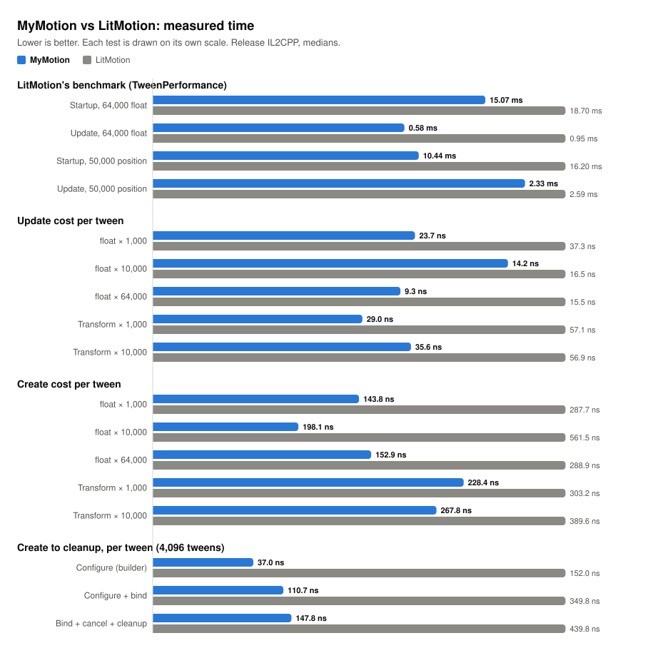
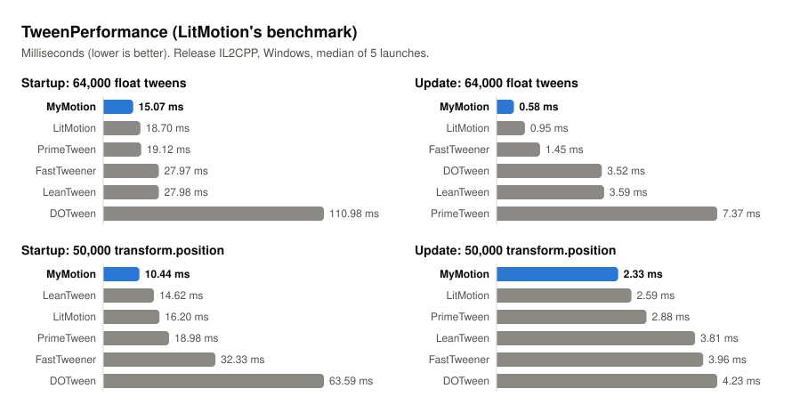
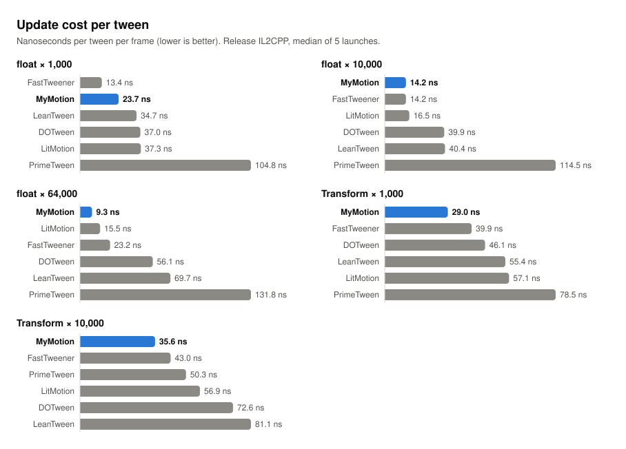
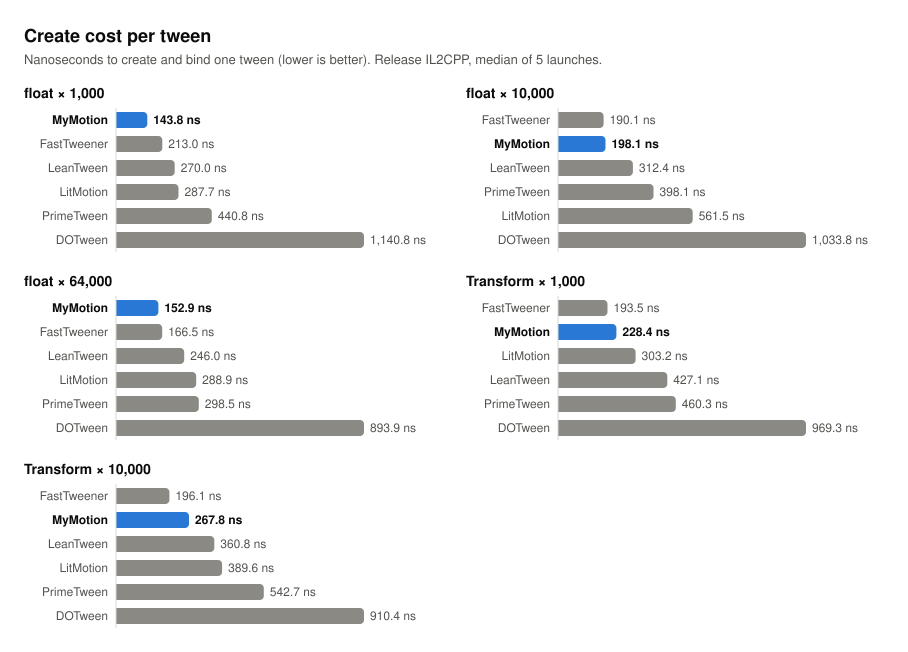
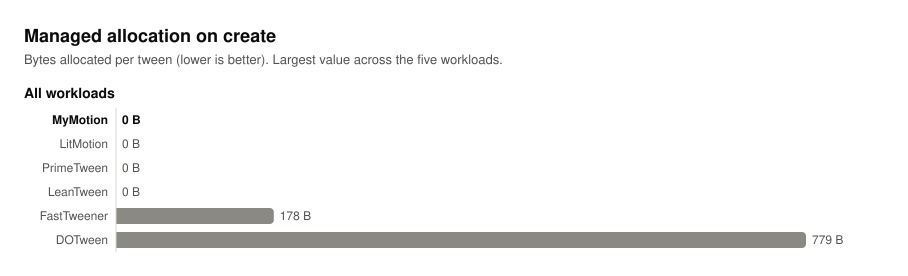

# 既存 Tween ライブラリとの性能比較

MyMotion の現行 Runtime と、代表的な Unity Tween ライブラリを同じ Release IL2CPP Player 条件で比較しました。

- **MyMotion は LitMotion より、Update が全5条件で13.9〜49.2%短く、Create が24.7〜64.7%短い結果でした。**
- 最小値を取るライブラリは条件で変わります。FastTweener は float 1,000件の Update と Transform 1,000件の Create が最短でした。MyMotion は float 64,000件と Transform 1,000件の Update が最短でした。

すべての値は1件あたりの ns で、小さいほど短時間です。Update は1フレーム分の時間を Tween 件数で割っています。表の太字はその条件の最小値です。

## LitMotion との比較のまとめ

17項目それぞれの MyMotion と LitMotion の実測時間です。すべての項目で MyMotion の方が短くなりました。項目ごとの順位表、作成からキャンセル・片付けまでの内訳、待機中のコストは [README の性能の節](../README_JA.md#性能)にまとめています。

## LitMotion 本家のベンチマーク（TweenPerformance）

LitMotion の README が載せている [TweenPerformance](https://github.com/AnnulusGames/TweenPerformance) の計測を、同じ Tween のコードと同じ測り方で再現しました。4項目すべてで MyMotion が最速です。

| 項目 | MyMotion | LitMotion | PrimeTween | FastTweener | LeanTween | DOTween |
|---|---:|---:|---:|---:|---:|---:|
| 開始、float 64,000件 | **15.07 ms** | 18.70 ms | 19.12 ms | 27.97 ms | 27.98 ms | 110.98 ms |
| 更新、float 64,000件 | **0.58 ms** | 0.95 ms | 7.37 ms | 1.45 ms | 3.59 ms | 3.52 ms |
| 開始、position 50,000件 | **10.44 ms** | 16.20 ms | 18.98 ms | 32.33 ms | 14.62 ms | 63.59 ms |
| 更新、position 50,000件 | **2.33 ms** | 2.59 ms | 2.88 ms | 3.96 ms | 3.81 ms | 4.23 ms |
| position Tween 1件あたりの GC | **0 B** | 0 B | 0 B | 563 B | 293 B | 780 B |

計測方法と本家との違いは [benchmarks/TweenPerformance](benchmarks/TweenPerformance/README.md)、生データは [results/tweenperformance-20261125.csv](results/tweenperformance-20261125.csv) にあります。

以下は、1件あたりのコストを細かく比べた独自の計測です。

## Update

| 条件 | MyMotion | MyMotion Deferred | LitMotion | PrimeTween | DOTween | LeanTween | FastTweener |
|---|---:|---:|---:|---:|---:|---:|---:|
| float 1,000件 | 23.7 | 16.5 | 37.3 | 104.8 | 37.0 | 34.7 | **13.4** |
| float 10,000件 | 14.2 | **12.8** | 16.5 | 114.5 | 39.9 | 40.4 | 14.2 |
| float 64,000件 | **9.3** | 9.8 | 15.5 | 131.8 | 56.1 | 69.7 | 23.2 |
| Transform 1,000件 | **29.0** | 29.7 | 57.1 | 78.5 | 46.1 | 55.4 | 39.9 |
| Transform 10,000件 | 35.6 | **34.8** | 56.9 | 50.3 | 72.6 | 81.1 | 43.0 |

## Create

| 条件 | MyMotion | MyMotion Deferred | LitMotion | PrimeTween | DOTween | LeanTween | FastTweener |
|---|---:|---:|---:|---:|---:|---:|---:|
| float 1,000件 | **143.8** | 175.5 | 287.7 | 440.8 | 1,140.8 | 270.0 | 213.0 |
| float 10,000件 | 198.1 | **164.3** | 561.5 | 398.1 | 1,033.8 | 312.4 | 190.1 |
| float 64,000件 | **152.9** | 153.6 | 288.9 | 298.5 | 893.9 | 246.0 | 166.5 |
| Transform 1,000件 | 228.4 | 199.8 | 303.2 | 460.3 | 969.3 | 427.1 | **193.5** |
| Transform 10,000件 | 267.8 | **186.5** | 389.6 | 542.7 | 910.4 | 360.8 | 196.1 |

MyMotion Deferred は `WithImmediateBind(false)` を指定した比較用の設定です。通常の MyMotion は Bind 時に初期値を適用します。

Create では、通常の MyMotion が float 1,000件と64,000件で最短でした。MyMotion Deferred は float 10,000件と Transform 10,000件、FastTweener は Transform 1,000件で最短でした。float 10,000件では FastTweener（190.1 ns）も通常の MyMotion（198.1 ns）より短い値でした。

## Create 時の managed GC 割り当て

| ライブラリ | 1 Tween あたり |
|---|---:|
| MyMotion | 0 byte |
| MyMotion Deferred | 0 byte |
| LitMotion | 0 byte |
| PrimeTween | 0 byte |
| LeanTween | 0〜0.4 byte |
| FastTweener | 143〜178 byte |
| DOTween | 684〜779 byte |

LeanTween の最大値は10,000件で記録した4,096 byteを1件あたりに換算した値です。生CSVの `create_gc_bytes` 列には起動ごとの合計 byte を記録し、この表では Tween 件数で割っています。

## 計測方法

- 2026-11-25、Windows 11、Intel Core i7-1185G7、Unity 6000.6.8f1 の Release IL2CPP Player。
- 6ライブラリと MyMotion Deferred 版について、5 workload を各5回、合計175プロセスで測定。ライブラリと workload ごとにプロセスを分け、5起動の中央値を採用。
- float のクラス field と `Transform.position` を対象に、Linear、Tween 時間1,000秒で実行。
- MyMotion、PrimeTween、DOTween、LeanTween、FastTweener は容量を70,000件に事前確保。LitMotion は事前確保なし。
- 全175行で `validated=True` を確認。
- バージョンは LitMotion 2.0.2、PrimeTween 1.5.3、LeanTween 2.50。DOTween と FastTweener は当時リポジトリに同梱されていたソースを使い、バージョン番号は記録していません。
- Unity Burst 2.0.0、Collections 6.6.0。

グラフは [docs/images/make_charts.py](images/make_charts.py) で集計CSVから生成しています（MyMotion Deferred は含めていません）。全175起動の値は[集計CSV](results/cross-library-current-20261125.csv)にあります。ハードウェア、Unity版、Tween数、対象バインディングによって結果は変わります。この測定は単一Windows環境での比較です。

## 参考

- [LitMotion の設計方針](https://github.com/annulusgames/LitMotion/blob/main/docs/articles/en/design-philosophy.md)
- [LitMotion repository](https://github.com/annulusgames/LitMotion)（benchmark source への案内を含む）
- [PrimeTween のベンチマークに関する議論](https://github.com/KyryloKuzyk/PrimeTween/discussions/10)
- [Unity Tween Performance ベンチマーク](https://github.com/AnnulusGames/TweenPerformance)
